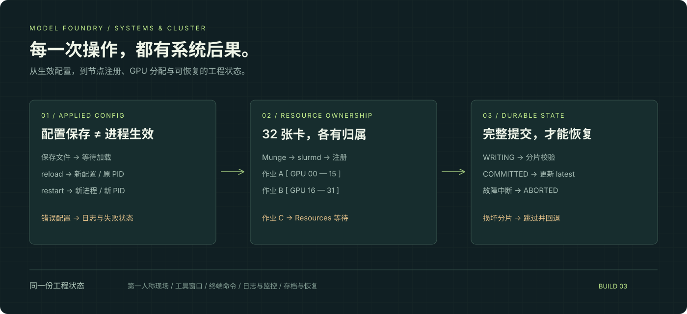

<div align="center">


# Model Foundry

### 无需真实 GPU，也能走进大模型工程现场。

第一人称 · 纯 HTML · 本地运行 · 工程全链路

[](#快速开始)
[](#快速开始)
[](#你的工程会留下来)
[](#项目状态)

[项目价值](#让工程实践从算力门槛中释放出来) · [体验设计](#你是一名工程师进入现场开始工作) · [快速开始](#快速开始) · [工程结构](#工程结构) · [项目状态](#项目状态)

</div>

## 让工程实践从算力门槛中释放出来

想进入大模型领域的人，常常先遇到一个现实问题：**还没机会理解完整工程，就已经被算力、环境和试错成本挡住。**

教程可以讲清一个参数，代码示例可以跑通一个步骤。完整的工程经验，还包括搭环境、准备数据、分配资源、开发脚本、观察训练、排查故障，以及把模型真正交付成服务。

**Model Foundry 希望把这些实践机会，带到一个普通浏览器里。**

你可以建设一套虚拟的大模型研发环境，在其中做决策、执行操作、观察后果、定位问题，再重新尝试。无需租用真实 GPU，也能接触大模型工程的系统结构、依赖关系与工作方式。

| 实践机会 | 项目希望带来的改变 |
| :--- | :--- |
| 接触完整工程 | 从设备与环境建设开始，一路走到模型服务交付 |
| 反复尝试方案 | 保存工程分支，比较数据、配置、资源与训练策略 |
| 经历失败与恢复 | 通过日志、文件、节点和服务状态定位问题 |
| 理解工程因果 | 让参数、资源、数据、训练和服务表现相互关联 |
| 降低环境门槛 | 用单个 HTML 承载可本地运行的工程世界 |

## 你是一名工程师，进入现场，开始工作

项目围绕第一人称工程体验展开：你走进实验室，在机房操作设备，到工位使用电脑，在开发工具、终端、实验平台和监控之间完成真实工程中的工作。

你接手的是 **Atlas 70B** 项目。设备已经到位，系统与平台需要建设，语料需要治理，模型需要训练，服务需要交付。

> 从“这台服务器为什么无法注册”，到“这次训练为什么中断”，再到“这个版本是否可以发布”——每个问题都应该能回到具体的工程对象和证据。


### 建设环境

建立节点、网络、存储、GPU 软件栈、容器与调度服务。让设备具备可用的身份、连接、运行环境和资源配置。

### 构建模型

接入语料，进行清洗、去重、分词与分片；编辑训练代码和配方，提交分布式任务，观察运行过程，管理检查点，完成后训练与实验比较。

### 交付服务

评测候选检查点，导出服务格式，注册模型版本，部署推理服务，观察并发压力下的队列、缓存与延迟。

### 处理问题

故障会影响已有的工程状态。定位原因、修复配置、恢复服务或续接检查点，形成可追溯的操作记录。

## 工程状态贯穿整个世界

Model Foundry 的核心是同一份持续存在的工程状态。

```text
现场操作 / 工具界面 / 终端命令
                ↓
          配置、事件与系统状态
                ↓
  节点 → 网络 → 存储 → 服务 → 数据 → 作业
                ↓
       日志、指标、检查点与模型版本
                ↓
         评测、部署与下一轮实验
```

文件系统、服务状态、调度作业和模型资产互相关联。终端与界面访问相同的对象，训练使用提交时绑定的数据和配置，历史运行保留自己的快照。

## 你的工程会留下来

- **本地存档**：保留节点、服务、数据、作业、检查点与模型状态。
- **工程导出与导入**：保存多个工程分支，便于复盘和比较。
- **统一工程时钟**：通过时间倍率观察长流程；关闭页面后冻结工程时间。
- **配置与运行血缘**：将代码、数据、训练、评测和模型版本联系起来。

## v0.5 · 从“显示输出”，走向逐步执行


**暂停一次请求、保存整个工程，再回来继续：执行位置和随机数都应该接得上。**

本版把评测和服务接到同一个逐步解码器。入队与 Prefill 不生成答案；每次 Decode 才抽取下一个 Token。请求保留上下文、采样次数、RNG、停止串和结束原因；暂停释放 KV，恢复先重建 KV，再继续原来的采样。

- **状态经得起中断**：暂停、项目刷新、恢复、取消和超时都作用于同一次执行。
- **指标经得起核对**：修复重复字符抬高 F1 的缺陷，按字符出现次数计算交集；报告保存评测协议。
- **参数经得起检查**：新训练按配方学习率与调度更新，去掉阶段隐藏倍率；未实现的框架调用报告源码错误。
- **历史经得起追溯**：旧报告保留并要求重新评测；已加载的模型继续服务，新发布按当前协议验收。

操作契约、独立数值例子与验收路径见 [真实性基准与执行验收](docs/真实性基准与执行验收.md)。这些改进提升执行机制的一致性，不代表已完成 Transformer 与真实 GPU 性能的完整复刻。

## v0.4 · 从配置界面，走向可执行的工程闭环


**改一行代码、换一版数据、调整一次配置，都应该留下可以检查的后果。**

本版将数据、脚本、训练、评测、模型产物和推理请求连接到执行机制：

| 你的操作 | 系统中的后果 |
| :--- | :--- |
| 修改前向函数或 loss mask | 重新执行 Python 项目模块，改变 Token 损失、梯度和优化器更新 |
| 写错字段或缺少文件 | 在具体源文件、行号与 Worker 阶段得到 traceback |
| 调整去重或混合比例 | 生成新的文档簇、数据分片与版本；历史实验保留旧快照 |
| 比较学习率与后训练方案 | 观察独立实验的训练/验证结果、资源占用和成本 |
| 调整发布门槛 | 固定检查点逐样本评测；未通过则阻止转换与注册 |
| 在模型转换时断开存储 | 留下 staging 失败记录，修复后重试，不发布半成品 |
| 重复发送长前缀 | 命中对应版本的 KV 缓存，减少可测量的 Prefill 工作 |
| 提高并发或缩小缓存 | 发生排队、KV 争用、重计算、超时或拒绝 |
| 发布候选版本或回滚 | 新请求切换路由，活动请求保留自己的模型与资产 |
| 关闭一个 GPU 节点 | 相关请求失败，副本寻找空闲健康节点重新加载 |

界面提供数据审计、Packing Inspector、源代码轨迹、实验比较、逐样本评测、模型转换、请求 Trace、灰度和回滚操作。工程使用 IndexedDB 保存，支持比旧版 localStorage 更大的完整存档。

具体操作、执行范围与验收方法见 [执行与推理规格](docs/执行与推理验收.md)。

## 系统底座 · 操作具有系统后果



这一版深化系统与集群底座。每台节点的服务进程、认证、注册、GPU 和检查点拥有各自的状态，界面与终端读取相同对象。

- **配置有生效边界**：保存、reload、restart 分别产生不同后果；可以查看 PID、配置代数和待应用变更。
- **集群需要逐节点建立**：分发 Munge 密钥，启动认证和 slurmd，检查 GRES，处理注册拒绝，再取得可调度节点。
- **资源真实发生竞争**：任务申请具体节点与 GPU 卡号；两个 16 卡作业可并行，第三个作业等待资源；支持优先级、hold/release、drain 和时间限制。
- **保存过程可能失败**：检查点逐分片写入，完整提交后才更新 latest；断电、断网、存储中断和分片损坏会影响恢复。
- **恢复有证据**：校验分片与状态，跳过不可用版本，恢复所选检查点的优化器、RNG 和数据游标。

可复现的操作与验收路径见 [系统与集群操作规格](docs/系统与集群验收.md)。系统底座与新的数据、脚本、训练及服务执行链共享同一份持久状态。

## 可以亲手完成什么

| 工程层级 | 当前可操作能力 |
| :--- | :--- |
| 第一人称现场 | 靠近机柜、开关柜门、拖接电源与网络线、上电、装机、重启；走到工位坐下与离座 |
| 工位与工具 | 窗口拖动、缩放、最大化与最小化；编辑器与浮动终端并排；BMC、Corpus Studio、MLflow 和 Grafana 的独立工作界面 |
| 系统建设 | 逐节点配置 netplan、校验地址和 DNS、安装运行时、编辑服务配置、启动守护进程、挂载共享存储、查看节点日志 |
| 数据工程 | 导入 JSONL、编辑记录、运行清洗 DAG、逐条检查精确/近似去重、污染与隐私处理，隔离文档簇，检查 BPE、标签、loss mask 和 Packing |
| 开发与训练 | 执行项目 Python 模块和前向函数、查看行级错误、提交多作业与参数扫描、比较损失/资源/成本 |
| 模型状态 | 逐 Token 损失与梯度、Adam 状态、assistant-only SFT、reference-policy DPO；检查点恢复对应代码与训练状态 |
| 评测与推理 | 固定检查点逐样本评测、带 I/O 和校验的分片转换、逐请求排队/缓存/生成、扩缩容、灰度、回滚与副本恢复 |
| 诊断与恢复 | 物理断网、错误 DNS、错误服务配置、存储中断、节点失联、显存不足与学习率异常的定位和恢复 |

专业工具界面参照相应软件的工作结构；当前并非这些软件全部功能或像素级界面的完整复制。

<details>
<summary><b>一次可以复现的故障与恢复</b></summary>

1. 在机柜上完成系统与网络配置。
2. 将 DNS 改为错误地址，保存并执行 `netplan apply`。
3. 尝试安装运行时，看到域名解析失败。
4. 检查配置与日志，将 DNS 修复为正确地址。
5. 重新应用配置并安装，节点进入可用状态。

训练过程中也可断开 IB 链路。Worker 会报告通信故障，修复物理连接后，需要从完整检查点恢复；诊断不会替你自动修复所有问题。

</details>

## 快速开始

下载项目后，用现代桌面浏览器打开 `index.html`。

开发目录中的打包产物也位于 `dist/index.html`。运行不需要安装 Python、Node.js、训练框架或 GPU 驱动。

| 操作 | 按键 |
| :--- | :--- |
| 移动 | `W` `A` `S` `D` |
| 观察 | 按住鼠标拖动 |
| 现场交互 | `E` |
| 靠近工位后坐下 / 离座 | `Tab` |
| 返回现场 | `Esc` |
| 工程手册 | `H` |

建议按“现场设备 → 基础环境 → 平台服务 → 数据 → 训练 → 评测 → 部署”的顺序体验。工程手册和现场目标提供下一步线索。

## 项目状态

当前发布版本为 **v0.5.0**。当前覆盖设备与系统建设、数据治理、可执行脚本、预训练、SFT、DPO、实验比较、逐样本评测、产物转换和服务发布的可操作闭环。具体变更与验证范围见 [更新记录](CHANGELOG.md)。

**工程仿真是项目定位；对全部真实软件和场景的 1∶1 覆盖是持续建设目标。** 当前版本不等同于完整 Linux、Python 或 CUDA 运行环境，也不会产生真正的 70B 模型权重。各版本的可用操作与验证范围以更新记录为准。

封面、流程图和执行架构图是项目原创示意图，用于说明体验与架构。

## 工程结构

```text
Model-Foundry/
├── index.html          # 可直接打开的单文件版本
├── dist/index.html     # 构建产物
├── src/
│   ├── engine.js       # 项目、服务、数据、训练与模型状态
│   ├── systems.js      # 设备、配置、数据处理、优化器与模型行为
│   ├── runtime.js      # 进程、配置快照、资源调度与分片提交
│   ├── python.js       # AST、项目模块与源文件错误定位
│   ├── corpus.js       # 数据治理、版本、Tokenizer 与 Packing
│   ├── learning.js     # 前向执行、梯度、后训练与评测
│   ├── decoder.js      # 可持久化的单步采样与停止控制
│   ├── serving.js      # 请求调度、KV、灰度与副本恢复
│   ├── artifacts.js    # 转换 I/O、分片校验与资产登记
│   ├── storage.js      # IndexedDB 原子工程存档
│   ├── lab-ui.js       # 数据、执行、评测与服务工作区
│   ├── operations.js   # 集群、服务进程、GPU 与恢复工作区
│   ├── scene.js        # WebGL 第一人称工程现场
│   ├── app.js          # 工位工具与交互控制
│   ├── campus.js       # 现场控制面板与专业工具窗口
│   ├── style.css       # 界面样式
│   └── index.html      # HTML 模板
├── assets/             # README 封面与流程图
├── build.mjs           # 无依赖单文件构建
├── preview.mjs         # 仅监听本机的预览服务
├── verify-v2.cjs       # 既有机制回归
├── verify-v3.cjs       # 系统与集群集成验证
├── verify-v4.cjs       # 数据/脚本/训练/服务全链验证
├── verify-v4-boundaries.cjs # 故障与 KV 不变量
├── verify-v5.cjs       # 独立计分、单步采样与暂停恢复验收
├── verify.mjs          # 全部验收入口
├── docs/               # 操作规格与验收路径
├── CHANGELOG.md
└── README.md
```

修改源文件后，在 Node.js 环境中执行：

```bash
node build.mjs
```

验证工程机制与启动本机预览：

```bash
node verify.mjs
node preview.mjs
# 浏览器访问 http://127.0.0.1:4175
```

生成的 HTML 内联全部运行资源，可以独立使用。README 的徽章使用在线图片，不属于应用运行依赖。

## 工程依据

开发前的研究记录整理了系统建设、数据、分布式训练、后训练、评测、部署与故障的目标行为，以及 36 组官方参考资料，见 [工程研究与复刻规格](docs/工程研究与复刻规格.txt)。研究中的长期目标与当前实现范围分别记录，便于逐项核对。

工程流程参考公开的官方资料，包括 [Megatron Bridge](https://docs.nvidia.com/nemo/megatron-bridge/latest/)、[Slurm](https://slurm.schedmd.com/documentation.html)、[NeMo](https://docs.nvidia.com/nemo/)、[vLLM](https://docs.vllm.ai/en/stable/)、[MLflow](https://mlflow.org/docs/latest/ml/tracking/) 与 [Kubernetes](https://kubernetes.io/docs/)。

这些项目提供真实工程机制的参照，Model Foundry 使用浏览器内的实现来组织相应体验，与上述项目没有官方隶属关系。

---

<div align="center">

**让更多人，获得亲手完成大模型工程的机会。**

[GitHub / lanszdg / Model-Foundry](https://github.com/lanszdg/Model-Foundry)

</div>
