<div align="center">

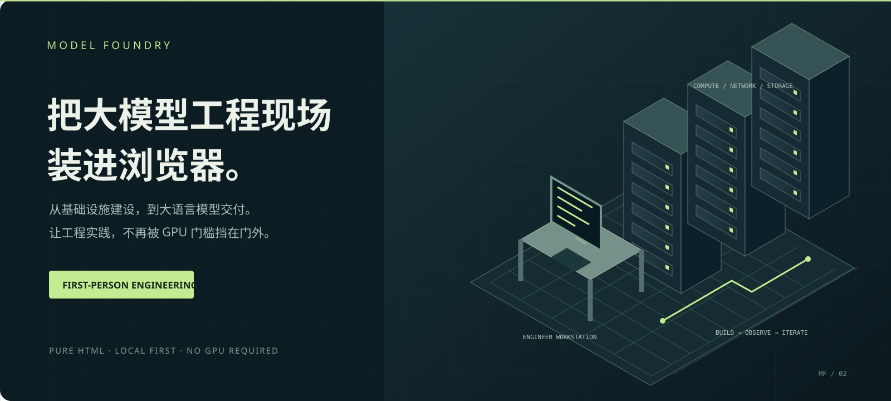

# Model Foundry

### 无需真实 GPU，也能走进大模型工程现场。

第一人称 · 纯 HTML · 本地运行 · 工程全链路

[](#快速开始)
[](#快速开始)
[](#你的工程会留下来)
[](#项目状态)

[项目价值](#让工程实践从算力门槛中释放出来) · [体验设计](#你是一名工程师进入现场开始工作) · [快速开始](#快速开始) · [工程结构](#工程结构) · [项目状态](#项目状态)

</div>

## 让工程实践从算力门槛中释放出来

想进入大模型领域的人，常常先遇到一个现实问题：**还没机会理解完整工程，就已经被算力、环境和试错成本挡住。**

教程可以讲清一个参数，代码示例可以跑通一个步骤。完整的工程经验，还包括搭环境、准备数据、分配资源、开发脚本、观察训练、排查故障，以及把模型真正交付成服务。

**Model Foundry 希望把这些实践机会，带到一个普通浏览器里。**

你可以建设一套虚拟的大模型研发环境，在其中做决策、执行操作、观察后果、定位问题，再重新尝试。无需租用真实 GPU，也能接触大模型工程的系统结构、依赖关系与工作方式。

| 实践机会 | 项目希望带来的改变 |
| :--- | :--- |
| 接触完整工程 | 从设备与环境建设开始，一路走到模型服务交付 |
| 反复尝试方案 | 保存工程分支，比较数据、配置、资源与训练策略 |
| 经历失败与恢复 | 通过日志、文件、节点和服务状态定位问题 |
| 理解工程因果 | 让参数、资源、数据、训练和服务表现相互关联 |
| 降低环境门槛 | 用单个 HTML 承载可本地运行的工程世界 |

## 把配置，变成可追溯的工程后果


v0.12 内联七条开放模型路线的 **221,493 个来源张量条目**。选择精度、并行方式、ZeRO、卸载和适配器后，按张量归属推导逐卡权重、训练状态和服务缓存；启动时检查 GPU 与每台主机的共同占用。DP 不再被误算成权重切分。

从“改完配置看一个估计数字”，进一步走到“资源不足会阻止启动，改结构会使旧产物失效，改评测规则必须重新验证”。这让成本规划、失败诊断和交付判断成为同一条工程链。

v0.12 新增 **168 项检查**；真实 MLflow 3.0.1 对照 25 个用例，真实 Grafana 12.0.0 / Prometheus 3.3.0 对照 29 个用例与 68 次告警状态采样。检查数量代表验证范围，不代表全产品真实性百分比。

新领域项目的结构配置会进入可微计算图；实验追踪增加可启动、可故障修复、可停止恢复的持久化 API。详细机制、来源和尚未闭合的官方内核范围见 [张量资源合同与原生对照](docs/张量资源合同与原生对照.md)。

## 让每一次修改，都进入工程因果链


**训练材料变了，梯度就应改变；网络变慢，任务就应等待；推理配置变了，交付就应重新验证。**

v0.15 把这些关系接进同一套执行约定：多模态 SFT 读取真正的 assistant 标签，视觉对齐和 SFT 使用不同训练范围；JEPA 推理与部署规划共同选择编码器；领域推理执行精度与 TP / PP / CP 配置。

通信从元数据进入训练时序。参数预取、梯度归约、更新同步等待共享 NVLink、IB 与 PCIe；并发项目争用链路，带宽变化改变等待时间，超时阻止未完成产物发布。在“批次与恢复”并排观察训练与通信，暂停后也能逐步推进工程时间。

本轮新增 **332 项检查**，累计 **3,126 项工程断言**；七条路线完成训练到部署推理验收。梯度屏障和更新同步期间保存后恢复，Adam 不会重复执行。详见 [执行协议与通信屏障验收](docs/执行协议与通信屏障验收.md)。

## 让“省显存”，成为可以检查的工程动作


改一个参数，不应只改变看板上的数字。**状态应该换一个地方保存，计算应该多做或少做一些工作，失败与恢复也应该沿着同一条路径发生。**

v0.14 为项目训练加入逐 rank 的参数、梯度和 Adam 状态。选择 ZeRO-1/2/3，实际缓冲随之分片；参数按需聚合、使用并释放。开启重计算，反向传播会重新执行计算块。临时聚合与反量化空间也进入容量规划，让“分片以后仍然可能 OOM”成为可检查的工程判断。

在“批次与恢复”直接查看每卡状态、CPU/GPU 位置、通信与重算次数。分片检查点可接着未完成的批次继续，导出的资产仍保留兼容的参数与优化器状态。

v0.14 的 **443 项新增检查**，累计 2,794 项工程断言；独立 NumPy 数值对照通过。浏览器中同一工程从 ZeRO-0 切换到 ZeRO-3，DP=2 时各卡参数、梯度和优化器状态减半，并完成检查点恢复。详见 [逐 rank 分片与重计算验收](docs/逐rank分片与重计算验收.md)。

## 让每份数据，走到一次参数更新

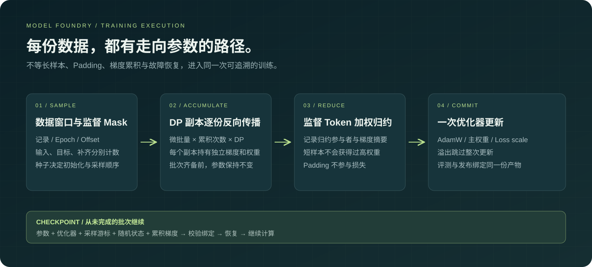

理解大模型训练，不能只看曲线。你还需要知道：**这次更新用了哪些数据？补齐有没有参与损失？梯度攒够了吗？失败后从哪里继续？**

v0.13 把每卡批量、序列长度、梯度累积与 DP 数据贡献接入实际项目计算。微批次完成前，参数保持不变；不同长度样本按监督 Token 加权，Padding 不参与损失。FP16 溢出会跳过整个批次，日志和采样游标保留这次尝试。

在“批次与恢复”中，直接观察 **样本 → 反向传播 → 梯度归约 → 优化器提交**。即使一个批次只完成了 1/16，也能保存检查点；取消后恢复，会接着原来的采样位置、随机状态和累积梯度继续。训练繁忙时，进度更新与操作控件保持可用。

v0.13 新增 **392 项执行检查**，当时累计 2,351 项工程断言，并覆盖七条模型路线的数据到推理闭环。数值内核仍有浏览器执行边界；完整机制、操作示例与范围见 [批次执行与检查点验收](docs/批次执行与检查点验收.md)。

## 你是一名工程师，进入现场，开始工作

项目围绕第一人称工程体验展开：你走进实验室，在机房操作设备，到工位使用电脑，在开发工具、终端、实验平台和监控之间完成真实工程中的工作。

你接手的是 **Atlas 70B** 项目。设备已经到位，系统与平台需要建设，语料需要治理，模型需要训练，服务需要交付。

> 从“这台服务器为什么无法注册”，到“这次训练为什么中断”，再到“这个版本是否可以发布”——每个问题都应该能回到具体的工程对象和证据。

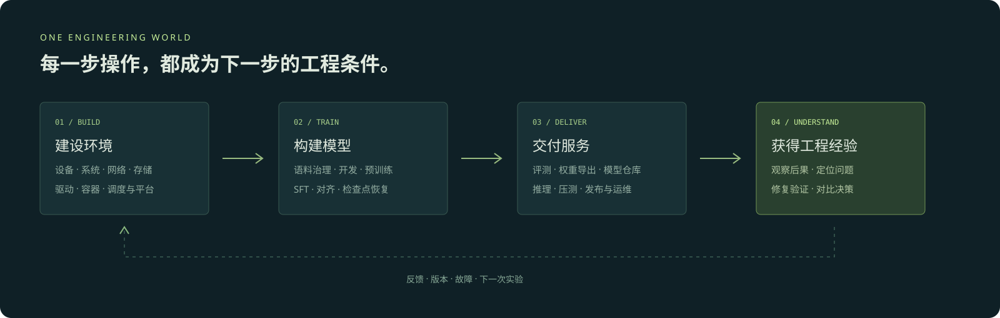

### 建设环境

建立节点、网络、存储、GPU 软件栈、容器与调度服务。让设备具备可用的身份、连接、运行环境和资源配置。

### 构建模型

接入语料，进行清洗、去重、分词与分片；编辑训练代码和配方，提交分布式任务，观察运行过程，管理检查点，完成后训练与实验比较。

### 交付服务

评测候选检查点，导出服务格式，注册模型版本，部署推理服务，观察并发压力下的队列、缓存与延迟。

### 处理问题

故障会影响已有的工程状态。定位原因、修复配置、恢复服务或续接检查点，形成可追溯的操作记录。

## 工程状态贯穿整个世界

Model Foundry 的核心是同一份持续存在的工程状态。

```text
现场操作 / 工具界面 / 终端命令
                ↓
          配置、事件与系统状态
                ↓
  节点 → 网络 → 存储 → 服务 → 数据 → 作业
                ↓
       日志、指标、检查点与模型版本
                ↓
         评测、部署与下一轮实验
```

文件系统、服务状态、调度作业和模型资产互相关联。终端与界面访问相同的对象，训练使用提交时绑定的数据和配置，历史运行保留自己的快照。

## 你的工程会留下来

- **本地存档**：保留节点、服务、数据、作业、检查点与模型状态。
- **工程导出与导入**：保存多个工程分支，便于复盘和比较。
- **统一工程时钟**：通过时间倍率观察长流程；关闭页面后冻结工程时间。
- **配置与运行血缘**：将代码、数据、训练、评测和模型版本联系起来。

## v0.11 · 配环境、跑任务、查证据、修故障

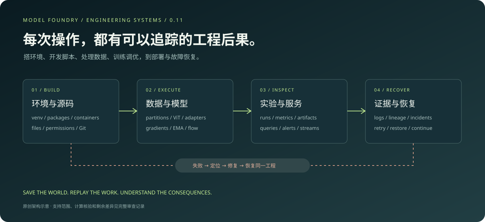

**把最昂贵的工程试错，变成可以保存、重放和反复练习的实操机会。**

本版把环境、开发、数据、训练和软件操作进一步连起来：依赖冲突会阻止安装，权限和只读挂载会拒绝写入，数据分区失败需要恢复，重新训练会使旧评测失效。每一步都留下对应文件、日志和状态。

| 实操路径 | 现在可以操作与检查的内容 |
| :--- | :--- |
| 建立研发环境 | 主机隔离的 venv、包版本约束、冲突处理、锁记录、SSH身份与文件权限 |
| 开发与版本管理 | 项目 Python 回调实际影响梯度；Git暂存、提交、分支、合并冲突对应同一工作区 |
| 处理数据 | 分区作业、失败重试、保留已提交结果、字节索引、摘要与数据来源撤回 |
| 训练与调优 | LoRA/QLoRA、冻结基座、适配器梯度、分组策略更新，以及打包INT4/INT8资产 |
| 世界与具身路线 | Patch注意力、独立EMA、未来预测、动作chunk、速度场积分、碰撞与抓取约束 |
| 实验与监控 | 跨项目运行筛选、指标、配置与资产；PromQL标签查询、采样时效与告警状态 |
| 部署与服务 | 评测绑定具体模型/数据/源码；HTTP状态、SSE分块、背压与断连取消共享服务状态 |

原固定100项已完整审查，每项记录源码依据与正常、错误、恢复条件。可操作的支持范围、修复证据和仍未覆盖的原生兼容机制见 [完整审查与落地记录](docs/完整工程审查与落地.md)。新增270项检查，并有独立NumPy计算参考；检查数量不代表软件复刻比例。

## v0.10 · 让模型结构进入计算，让源码操作产生结果

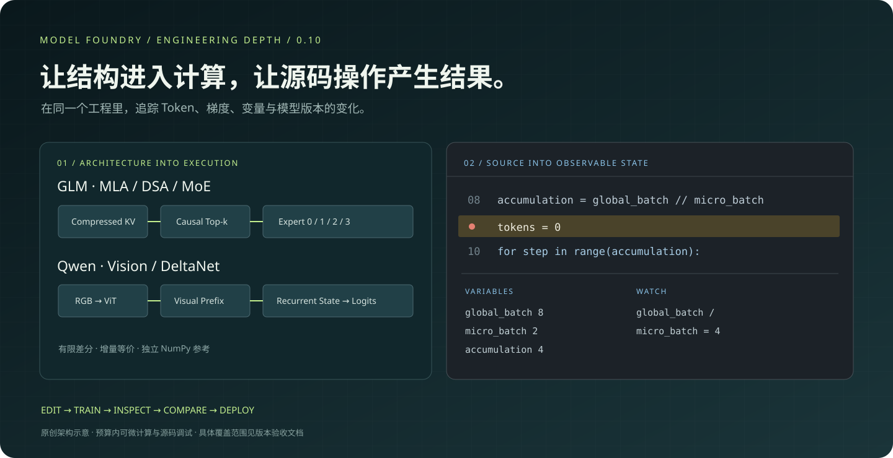

**同一条工程链，既能追到一个专家接收了哪些 Token，也能停在一行代码前，看清变量为什么变成这个值。**

本版深化两条已有模型路线：GLM-5.3 接入压缩 KV、稀疏索引选择与专家路由；Qwen3.8 接入循环 DeltaNet、门控注意力和可训练视觉编码。调整结构、数据和训练配方后，前向输出、梯度、权重及后续服务会随计算改变。

| 你可以亲手做的事 | 可以看到的依据 |
| :--- | :--- |
| 修改项目 architecture.json | 层数、张量形状、参数分配及后续阶段的结构校验 |
| 用图文样本训练 Qwen 路线 | RGB 图像变为视觉前缀，语言损失反传到视觉参数 |
| 检查 GLM 路线的路由 | 每层因果 Token 选择、专家分配和实际负载 |
| 对比两次实验 | 实测 loss、数据与源码摘要、变化参数数量与 L2 距离 |
| 在 Code 中停住程序 | 行断点、F10 越过、F11 进入函数、局部变量与 Watch |
| 跨文件查找并修改配置 | 跳转到源文件行号、保存、语法检查与实际错误回溯 |

新增 404 项检查；两条数值路径另经独立 NumPy 前向核对。它们是明确限定尺寸的架构实现，尚不包含官方完整规模权重、全部算子和原生软件兼容性。具体算子、操作步骤、独立误差与剩余范围见 [原生算子与源码调试验收](docs/原生算子与源码调试验收.md)。

## v0.9 · 从一个模型，扩展到多种工程世界

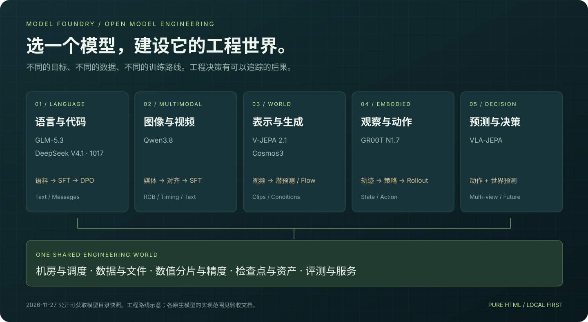

**选择模型之后，数据、环境、训练阶段和交付形式一起改变。**

按 2026-11-27 官方公开获取状态核查，目录包含 GLM-5.3、DeepSeek-V4.1-Flash-1017、Qwen3.8-27B、V-JEPA 2.1、Cosmos3-Nano、GR00T N1.7 和 VLA-JEPA。GLM-5.4 保留在发布观察，等待官方权重开放。每个入口都有官方资料来源。

从模型目录创建项目后，可以编辑专属数据和配方、准备环境、占用机房里的 GPU、提交各阶段、检查数值分片、评测并部署。同一批节点、存储、文件、调度与监控贯穿这些操作。机器人数据需要状态、动作和时间同步，世界模型需要视频与未来预测目标；它们拥有自己的工程图。

- **训练可以核对**：局部矩阵实际参与前向与反向，记录切分区间、梯度和通信摘要。
- **精度产生后果**：BF16/FP16 舍入、FP32 master 与 moments、FP16 溢出跳步及 loss scaling 随状态保存。
- **发布需要证据**：独立验证集与闭环距离门槛决定评测是否通过，导出检查当前协议的报告。
- **服务可以操作**：发送样本请求，检查绑定版本的动作、潜表示或数值输出，以及策略控制的反馈轨迹。

本轮使用可训练的有预算参考内核组织工程体验。各原生模型的 DSA、Engram、视觉编码器、VAE/DiT 等尚未完整逐算子复刻；目录和阶段流程的接通不代表已在浏览器训练这些官方完整模型。实现、具体差异与验收路径见 [开放模型工程与数值分片验收](docs/开放模型工程与数值分片验收.md)。原有 Dense Atlas 的 100 项清单仍为 49 项闭环，多领域扩展单独记录。

## v0.8 · 一份规格，连接每一步工程决策

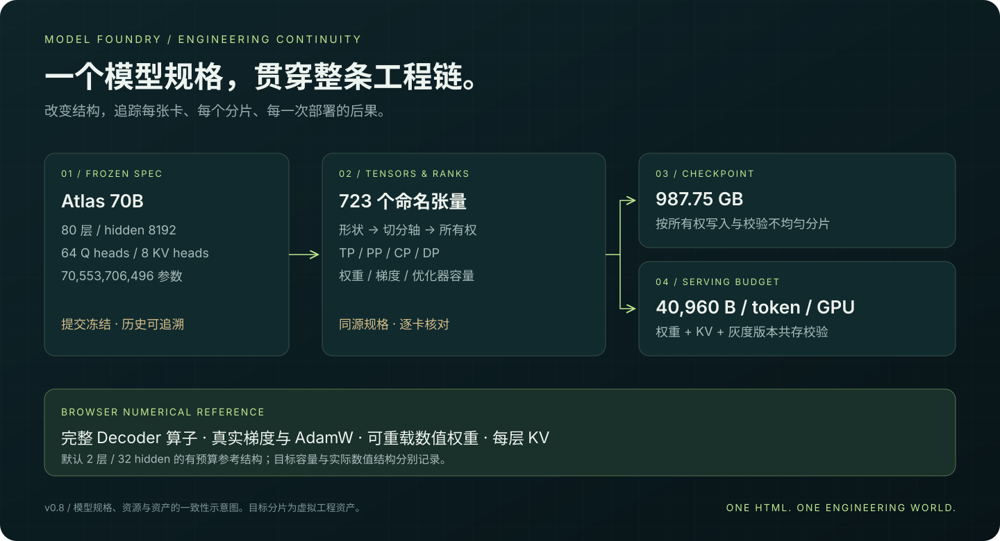

**你修改的模型结构，应该真正改变后面的资源、文件和服务。**

新任务统一读取 `model-spec.json`，提交时冻结。Atlas 70B 的 723 个命名张量、70,553,706,496 个逻辑参数，从张量形状逐项得出，再进入逐卡资源、流水线范围、检查点和模型转换。推理端也从相同规格计算权重与 KV 容量，错误配置在破坏已有服务之前失败。

| 工程决策 | 可以核对的后果 |
| :--- | :--- |
| 调整模型结构 | 新任务重新生成张量形状、资源预算与冻结产物 |
| 选择一张 GPU | 看到切分轴、实际区间、本地张量和优化器容量 |
| 写入或恢复检查点 | 分片容量符合各 rank 的所有权，状态接续一致 |
| 转换和加载模型 | 校验所有张量、配置、Tokenizer、精度及容量 |
| 调整 KV 或灰度发布 | 检查显存与版本共存预算，失败保留原服务 |
| 在终端组合命令 | 引号、变量、管道、重定向和退出码参与实际执行 |
| 修改 Python 张量操作 | reshape、索引、归约保留形状和梯度，错误准确失败 |

终端现在可以执行 `printf "a\nb\na\n" | grep -n a | wc -l`，也能用带筛选与格式参数的 Slurm 查询查看同一份任务状态。Tensor 与终端遵循明确的支持范围；详情见 [统一模型与操作语义验收](docs/统一模型与操作语义验收.md)。

**完成度可以逐项追踪。** 按固定 100 项工程场景自评，v0.7 为 41 项闭环，v0.8 为 **49 项闭环、34 项部分实现、17 项未实现**。部分实现不折算分数；49% 是内部场景闭环率，不是工程真实性百分比。外部软件逐项对照尚未验收。完整定义和缺口见 [工程场景完成度清单](docs/工程场景完成度清单.md)。

本版通过 **795 项内部检查**与独立 NumPy Transformer 前向参考；检查数量和场景完成度分别记录。目标 70B 分片是虚拟工程资产，浏览器实际数值模型沿用下方说明的有预算 Transformer。

## v0.7 · 模型内部，也成为可以操作的现场

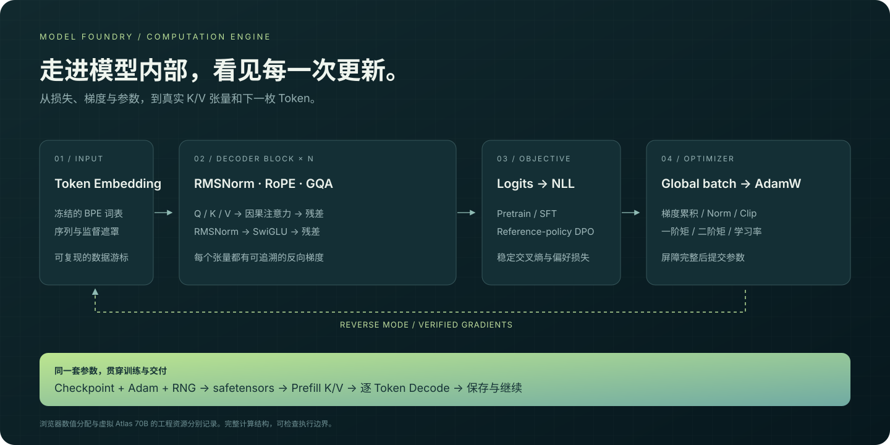

**看见一次参数更新从哪里来，知道下一枚 Token 为什么发生变化。**

新任务使用带完整前向与反向路径的 decoder-only Transformer：RMSNorm、RoPE、因果 GQA、SwiGLU、残差、LM head 与交叉熵。语料、loss mask、学习率和后训练目标，会改变实际张量与梯度。

| 你能亲手检查 | 对应的执行证据 |
| :--- | :--- |
| 选择一层、一个 Query Head | 查看真实注意力概率、因果遮罩和语料 Token |
| 改变脚本中的损失 | 梯度经过全层反向传播，影响一次完整 AdamW 更新 |
| 比较预训练、SFT 与 DPO | 使用相同模型结构、父检查点和冻结 reference policy |
| 在训练中保存、刷新、恢复 | 参数、Adam moments、RNG 与数据游标保持一致 |
| 下载与重载模型权重 | 实际 safetensors 字节、矩阵轴映射与摘要校验 |
| 重复发送相同前缀 | 复用每层真实 K/V 张量，减少实际前向 Token 工作 |

训练页新增 **Transformer 内核**，将工程资源视图与数值检查放进同一个工作区。运行仍由单文件 HTML 承载，无需安装 GPU 驱动或下载外部计算运行时。

虚拟 Atlas 70B 负责完整机房、资源和分布式工程场景；浏览器数值结构采用显式执行预算，默认 2 层、32 hidden、4 Q heads、1 KV head，覆盖完整计算结构。这不会产生具有真实 70B 规模与能力的参数。实现、独立数值参考和可复现路径见 [Transformer 数值内核与验收](docs/Transformer数值内核与验收.md)。

## v0.6 · 走到每一张 GPU

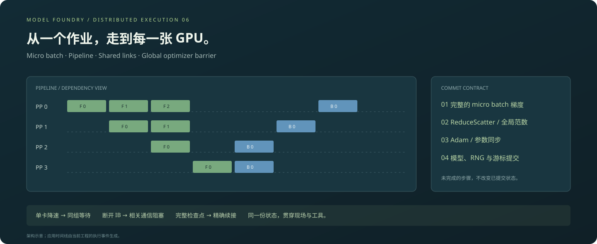

**能提交一个训练任务，还应该能回答：哪张卡在计算，哪张卡在等待，等待的是哪个依赖。**

本版将每张 GPU 绑定到物理节点与卡号，按 TP/CP/DP/PP 生成通信组，以非交错 1F1B 推进 micro batch。整批梯度、全局 norm、Adam 和参数同步全部完成后，模型与数据游标才更新一次。

| 你的操作 | 可以检查的工程后果 |
| :--- | :--- |
| 改变并行布局 | rank 坐标、流水线切分、通信参与者和资源占用随之变化 |
| 限制一张卡的算力 | 同组快卡等待，整步耗时增加；数据和数值更新保持可复现 |
| 开启 activation recompute | 时间线增加重计算，保留激活减少，显存与计算形成取舍 |
| 启用 CPU optimizer offload | 增加主机内存、PCIe D2H、CPU Adam 和 H2D 工作 |
| 让多个作业共享网络 | 相同 HCA、Spine 与存储预算产生争用 |
| 拔出跨节点 IB 链路 | 相关通信阻塞，watchdog 给出具体 rank 与端点；未完成步骤不提交 |
| 在 backward 中刷新工程 | 重建未提交步骤的数值工作，保持参数、Adam、RNG 与数据游标一致 |

训练页提供暂停/逐事件推进、逐卡状态、流水线时间线、通信组、损失曲线、实验扫描、检查点分片与冻结源码。内置 Worker 执行数值工作，页面仍可操作；全部代码随单文件 HTML 交付。

操作、资源假设和可复现路径见 [逐 GPU 执行与资源验收](docs/逐GPU执行与资源验收.md)。rank 级工程机制、浏览器数值分配与 CUDA 实现的边界分别记录，不使用检查数量表示复刻完成率。

## v0.5 · 从“显示输出”，走向逐步执行

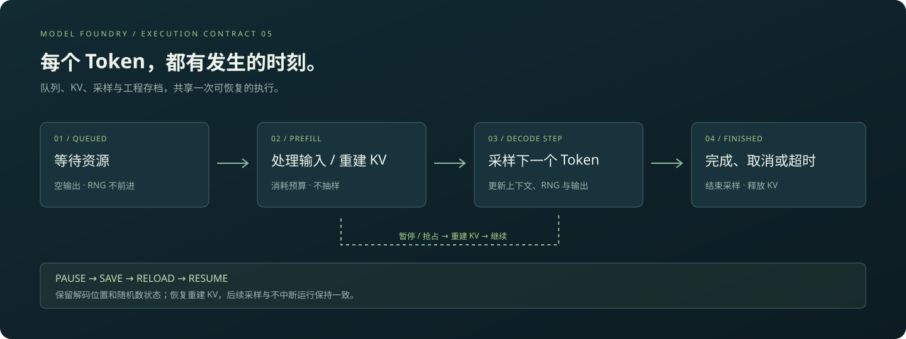

**暂停一次请求、保存整个工程，再回来继续：执行位置和随机数都应该接得上。**

本版把评测和服务接到同一个逐步解码器。入队与 Prefill 不生成答案；每次 Decode 才抽取下一个 Token。请求保留上下文、采样次数、RNG、停止串和结束原因；暂停释放 KV，恢复先重建 KV，再继续原来的采样。

- **状态经得起中断**：暂停、项目刷新、恢复、取消和超时都作用于同一次执行。
- **指标经得起核对**：修复重复字符抬高 F1 的缺陷，按字符出现次数计算交集；报告保存评测协议。
- **参数经得起检查**：新训练按配方学习率与调度更新，去掉阶段隐藏倍率；未实现的框架调用报告源码错误。
- **历史经得起追溯**：旧报告保留并要求重新评测；已加载的模型继续服务，新发布按当前协议验收。

操作契约、独立数值例子与验收路径见 [真实性基准与执行验收](docs/真实性基准与执行验收.md)。这些改进提升执行机制的一致性，新内核与历史执行协议分别验收，真实 GPU 性能仍需独立标定。

## v0.4 · 从配置界面，走向可执行的工程闭环

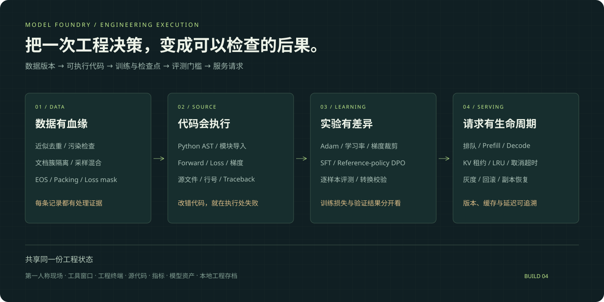

**改一行代码、换一版数据、调整一次配置，都应该留下可以检查的后果。**

本版将数据、脚本、训练、评测、模型产物和推理请求连接到执行机制：

| 你的操作 | 系统中的后果 |
| :--- | :--- |
| 修改前向函数或 loss mask | 重新执行 Python 项目模块，改变 Token 损失、梯度和优化器更新 |
| 写错字段或缺少文件 | 在具体源文件、行号与 Worker 阶段得到 traceback |
| 调整去重或混合比例 | 生成新的文档簇、数据分片与版本；历史实验保留旧快照 |
| 比较学习率与后训练方案 | 观察独立实验的训练/验证结果、资源占用和成本 |
| 调整发布门槛 | 固定检查点逐样本评测；未通过则阻止转换与注册 |
| 在模型转换时断开存储 | 留下 staging 失败记录，修复后重试，不发布半成品 |
| 重复发送长前缀 | 命中对应版本的 KV 缓存，减少可测量的 Prefill 工作 |
| 提高并发或缩小缓存 | 发生排队、KV 争用、重计算、超时或拒绝 |
| 发布候选版本或回滚 | 新请求切换路由，活动请求保留自己的模型与资产 |
| 关闭一个 GPU 节点 | 相关请求失败，副本寻找空闲健康节点重新加载 |

界面提供数据审计、Packing Inspector、源代码轨迹、实验比较、逐样本评测、模型转换、请求 Trace、灰度和回滚操作。工程使用 IndexedDB 保存，支持比旧版 localStorage 更大的完整存档。

具体操作、执行范围与验收方法见 [执行与推理规格](docs/执行与推理验收.md)。

## 系统底座 · 操作具有系统后果


这一版深化系统与集群底座。每台节点的服务进程、认证、注册、GPU 和检查点拥有各自的状态，界面与终端读取相同对象。

- **配置有生效边界**：保存、reload、restart 分别产生不同后果；可以查看 PID、配置代数和待应用变更。
- **集群需要逐节点建立**：分发 Munge 密钥，启动认证和 slurmd，检查 GRES，处理注册拒绝，再取得可调度节点。
- **资源真实发生竞争**：任务申请具体节点与 GPU 卡号；两个 16 卡作业可并行，第三个作业等待资源；支持优先级、hold/release、drain 和时间限制。
- **保存过程可能失败**：检查点逐分片写入，完整提交后才更新 latest；断电、断网、存储中断和分片损坏会影响恢复。
- **恢复有证据**：校验分片与状态，跳过不可用版本，恢复所选检查点的优化器、RNG 和数据游标。

可复现的操作与验收路径见 [系统与集群操作规格](docs/系统与集群验收.md)。系统底座与新的数据、脚本、训练及服务执行链共享同一份持久状态。

## 可以亲手完成什么

| 工程层级 | 当前可操作能力 |
| :--- | :--- |
| 第一人称现场 | 靠近机柜、开关柜门、拖接电源与网络线、上电、装机、重启；走到工位坐下与离座 |
| 工位与工具 | 窗口拖动、缩放、最大化与最小化；编辑器与浮动终端并排；BMC、Corpus Studio、MLflow 和 Grafana 的独立工作界面 |
| 系统建设 | 逐节点配置 netplan、校验地址和 DNS、安装运行时、编辑服务配置、启动守护进程、挂载共享存储、查看节点日志 |
| 数据工程 | 导入 JSONL、编辑记录、运行清洗 DAG、逐条检查精确/近似去重、污染与隐私处理，隔离文档簇，检查 BPE、标签、loss mask 和 Packing |
| 开发与训练 | 执行项目 Python 模块和前向函数、查看行级错误、提交多作业与参数扫描、比较损失/资源/成本 |
| 模型状态 | 完整 decoder-only Transformer 前向/反向、AdamW、assistant-only SFT、reference-policy DPO；检查点恢复数值参数与训练状态 |
| 评测与推理 | 固定检查点逐样本评测、带 I/O 和校验的分片转换、逐请求排队/缓存/生成、扩缩容、灰度、回滚与副本恢复 |
| 诊断与恢复 | 物理断网、错误 DNS、错误服务配置、存储中断、节点失联、显存不足与学习率异常的定位和恢复 |

专业工具界面参照相应软件的工作结构；当前并非这些软件全部功能或像素级界面的完整复制。

<details>
<summary><b>一次可以复现的故障与恢复</b></summary>

1. 在机柜上完成系统与网络配置。
2. 将 DNS 改为错误地址，保存并执行 `netplan apply`。
3. 尝试安装运行时，看到域名解析失败。
4. 检查配置与日志，将 DNS 修复为正确地址。
5. 重新应用配置并安装，节点进入可用状态。

训练过程中也可断开 IB 链路。Worker 会报告通信故障，修复物理连接后，需要从完整检查点恢复；诊断不会替你自动修复所有问题。

</details>

## 快速开始

下载项目后，用现代桌面浏览器打开 `index.html`。

开发目录中的打包产物也位于 `dist/index.html`。运行不需要安装 Python、Node.js、训练框架或 GPU 驱动。

| 操作 | 按键 |
| :--- | :--- |
| 移动 | `W` `A` `S` `D` |
| 观察 | 按住鼠标拖动 |
| 现场交互 | `E` |
| 靠近工位后坐下 / 离座 | `Tab` |
| 返回现场 | `Esc` |
| 工程手册 | `H` |

建议按“现场设备 → 基础环境 → 平台服务 → 数据 → 训练 → 评测 → 部署”的顺序体验。工程手册和现场目标提供下一步线索。

## 项目状态

当前发布版本为 **v0.15.0**。当前覆盖设备与系统建设、数据治理、可执行脚本、预训练、SFT、DPO、实验比较、逐样本评测、产物转换和服务发布的可操作闭环。具体变更与验证范围见 [更新记录](CHANGELOG.md)。

**工程仿真是项目定位；对全部真实软件和场景的 1∶1 覆盖是持续建设目标。** 当前版本不等同于完整 Linux、Python 或 CUDA 运行环境，也不会产生真正的 70B 模型权重。各版本的可用操作与验证范围以更新记录为准。

封面、流程图和执行架构图是项目原创示意图，用于说明体验与架构。

## 工程结构

```text
Model-Foundry/
├── index.html          # 可直接打开的单文件版本
├── dist/index.html     # 构建产物
├── src/
│   ├── engine.js       # 项目、服务、数据、训练与模型状态
│   ├── systems.js      # 设备、配置、数据处理、优化器与模型行为
│   ├── runtime.js      # 进程、配置快照、资源调度与分片提交
│   ├── python.js       # AST、项目模块与源文件错误定位
│   ├── corpus.js       # 数据治理、版本、Tokenizer 与 Packing
│   ├── model-catalog.js # 最新可获取模型、官方来源和领域阶段
│   ├── model-lab.js    # 分领域项目、共享资源、训练与策略服务
│   ├── sharded-training.js # Rank 状态所有权、分片更新与参数暂存
│   ├── project-training.js # 冻结批次、数据采样、梯度屏障与检查点
│   ├── model-lab-ui.js # 模型目录、工程图、文件与闭环工作台
│   ├── rank-numerics.js # 实际局部矩阵、通信与混合精度
│   ├── model-spec.js  # 统一目标模型、命名张量与逐卡所有权
│   ├── terminal.js    # Shell 数据流、退出码与严格查询参数
│   ├── model-contract.js # 任务、转换、服务资产与容量契约
│   ├── acceptance.js  # 固定 100 项场景与完成度口径
│   ├── engineering.js # 环境、权限、容器、Git、数据任务与告警
│   ├── engineering-ui.js # 环境/源码/MLflow/Grafana工作流
│   ├── adaptation.js # LoRA/QLoRA、分组策略梯度与打包权重
│   ├── domain-kernels.js # Patch ViT、EMA与条件velocity flow
│   ├── service-protocol.js # HTTP/SSE、背压与断连
│   ├── model-topology.js # 官方checkpoint配置与未知字段
│   ├── native-decoder.js # MLA/DSA/MoE、DeltaNet 与视觉前缀
│   ├── debugger.js    # 冻结源码、语句断点、单步与 Watch
│   ├── studio.js      # 文件、搜索、编辑与源码调试工作区
│   ├── transformer.js # RMSNorm / RoPE / GQA / SwiGLU 与反向传播
│   ├── transformer-decoder.js # 每层数值 KV 与增量解码
│   ├── transformer-tools.js # 张量检查与 safetensors 资产
│   ├── learning.js     # 前向执行、梯度、后训练与评测
│   ├── accumulation.js # 整批采样、Token 加权梯度与全局更新
│   ├── distributed.js  # 物理 rank、1F1B、通信与资源争用
│   ├── distributed-ui.js # 逐卡、时间线、实验和检查点工作区
│   ├── training-worker.js # 内置数值 Worker 协议
│   ├── decoder.js      # 可持久化的单步采样与停止控制
│   ├── serving.js      # 请求调度、KV、灰度与副本恢复
│   ├── artifacts.js    # 转换 I/O、分片校验与资产登记
│   ├── storage.js      # IndexedDB 原子工程存档
│   ├── lab-ui.js       # 数据、执行、评测与服务工作区
│   ├── operations.js   # 集群、服务进程、GPU 与恢复工作区
│   ├── scene.js        # WebGL 第一人称工程现场
│   ├── app.js          # 工位工具与交互控制
│   ├── campus.js       # 现场控制面板与专业工具窗口
│   ├── style.css       # 界面样式
│   └── index.html      # HTML 模板
├── assets/             # README 封面与流程图
├── build.mjs           # 无依赖单文件构建
├── preview.mjs         # 仅监听本机的预览服务
├── verify-v2.cjs       # 既有机制回归
├── verify-v3.cjs       # 系统与集群集成验证
├── verify-v4.cjs       # 数据/脚本/训练/服务全链验证
├── verify-v4-boundaries.cjs # 故障与 KV 不变量
├── verify-v5.cjs       # 独立计分、单步采样与暂停恢复验收
├── verify-v6.cjs       # 逐卡依赖、全局梯度与资源故障验收
├── verify-v7.cjs       # 梯度、数值缓存、权重字节与全流程验收
├── verify-v9.cjs       # 数值分片、AMP 与各领域工程验收
├── verify-v8.cjs       # Tensor、Shell、模型一致性与服务预算验收
├── progress.mjs        # 生成工程场景完成度清单
├── verify-transformer-reference.py # 可选的独立 NumPy 前向参考
├── verify.mjs          # 全部验收入口
├── docs/               # 操作规格与验收路径
├── CHANGELOG.md
└── README.md
```

修改源文件后，在 Node.js 环境中执行：

```bash
node build.mjs
```

验证工程机制与启动本机预览：

```bash
node verify.mjs
node preview.mjs
# 浏览器访问 http://127.0.0.1:4175
```

生成的 HTML 内联全部运行资源，可以独立使用。README 的徽章使用在线图片，不属于应用运行依赖。

## 工程依据

开发前的研究记录整理了系统建设、数据、分布式训练、后训练、评测、部署与故障的目标行为，以及 36 组官方参考资料，见 [工程研究与复刻规格](docs/工程研究与复刻规格.txt)。研究中的长期目标与当前实现范围分别记录，便于逐项核对。

工程流程参考公开的官方资料，包括 [Megatron Bridge](https://docs.nvidia.com/nemo/megatron-bridge/latest/)、[Slurm](https://slurm.schedmd.com/documentation.html)、[NeMo](https://docs.nvidia.com/nemo/)、[vLLM](https://docs.vllm.ai/en/stable/)、[MLflow](https://mlflow.org/docs/latest/ml/tracking/) 与 [Kubernetes](https://kubernetes.io/docs/)。

这些项目提供真实工程机制的参照，Model Foundry 使用浏览器内的实现来组织相应体验，与上述项目没有官方隶属关系。

---

<div align="center">

**让更多人，获得亲手完成大模型工程的机会。**

[GitHub / lanszdg / Model-Foundry](https://github.com/lanszdg/Model-Foundry)

</div>
