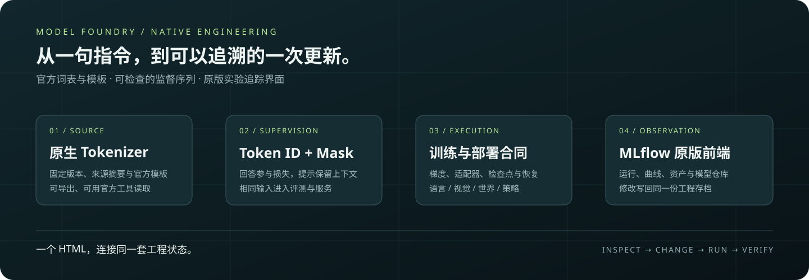
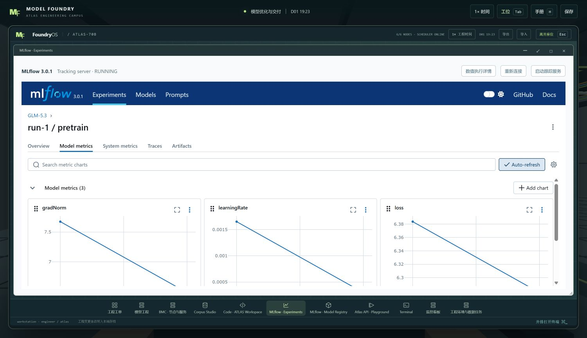

# 原生分词与软件界面验收 · v0.16

本次把原生词表、官方聊天模板和 MLflow 原版前端接进工程状态。目标是让一次编辑、一次训练和一次软件操作产生可以核对的共同结果。

## 已落地的路径

| 路线 | 文本来源 | 实际执行路径 |
| --- | --- | --- |
| GLM-5.3 | 固定版本的官方 tokenizer.json / config / template | 原生 ID → 项目词表投影 → 预训练、SFT、DPO → 评测、导出、部署、GUI/API 推理 |
| DeepSeek-V4.1-Flash-1017 | 同上 | 同上，并验证原生提示进入 GRPO |
| Qwen3.8-27B | 官方多模态 Tokenizer 与模板 | 图像/视频标记及原生 ID → 视觉对齐、SFT → 评测与服务 |
| Cosmos3-Nano | 根目录文本分支和 text_tokenizer 生成分支 | 原生指令 ID → 条件嵌入 → 视频 flow → 评测与部署 |
| GR00T N1.7 | 官方 processor 指向的文本依赖；三份公开等价文件经 Git blob 对齐 | 原生指令 ID → 条件嵌入 → 动作策略适配与微调 → 评测与部署 |
| VLA-JEPA | 官方 processor 指向的 Qwen3-VL 文本依赖 | 原生指令 ID → 联合动作/世界目标 → 评测与部署 |
| V-JEPA 2.1 | 纯视觉，不添加文本分词器 | 帧、Patch、目标编码器与评测部署沿用既有视觉路径 |

七个 Tokenizer/分支入口共用五份去重后的完整词表数据。模型、下载地址、原始文件 SHA256、固定 revision 和 GR00T 的公开等价文件证据见 [来源清单](原生Tokenizer来源.json)。这里没有下载或分发预训练权重。

### 数据、监督和服务

数据检查生成 `tokenizer-manifest.json`、`tokenized.jsonl` 和 `chat_template.jinja`。原生模板直接渲染会话；Assistant Mask 对应实际序列，只有回答部分进入 SFT 损失。改变回答会改变数值损失和梯度。

模型、优化器绑定、工程检查点、评测与部署合同保存 Tokenizer 来源摘要和投影摘要。修改已部署模型的模板配置会触发 409，要求重新评测和发布。GUI 与 HTTP 服务共享输入构造，贪心输出已经逐 Token 对照。

完整上游词表用于编码和解码。浏览器中的可微网络使用项目局部的稠密词表投影，最多 4096 行；投影行保存真实原生 ID，并保留所有字节符号和特殊 Token。投影只拟合训练分片；验证或服务遇到未收录的 BPE Token，按原生字节符号展开并保留文本。**这不是官方完整词表 softmax 的数值复刻。**

领域网络也使用原生 ID 选择条件嵌入；推理轨迹记录实际条件 ID。当前条件编码仍是有界参考结构，尚未替换为各官方完整文本骨干。Cosmos 可以在配方中设置 `textTokenizer: "cosmos3-nano:generator"`，切换分支后需要重建上游训练产物。

Tokenizer 工作台可以编码文本、渲染会话、检查 Mask、保存序列和导出 TAR。实际下载的 GLM TAR 已由官方 Rust `Tokenizer.from_str` 读取并编码。JSON 内容保留来源配置，导出的空白排版与原始文件不同。

词表按所选模型加载；首页不再等待全部词表解压与初始化。恢复活动工程时先载入其绑定的分词器，再推进计算，避免默默退回字节协议。

### 软件界面与共享状态

内联的是 MLflow 3.0.1 发布包中的原版前端资源，解压后字节保持不变；前端运行在工位 iframe 中，通过本地消息桥接到工程的 REST / GraphQL 服务。原始 Graphene schema 参与查询校验。服务需在工程中安装并启动，停止服务会返回 503。

接通实验创建、搜索、重命名、删除与恢复；运行查询、标签、参数和指标；产物目录与文件预览/下载；模型登记、版本、描述、标签、阶段与别名。项目训练运行和原版界面共享同一存储。人工改名、追加参数/指标不会被训练同步覆盖；世界存档恢复保留这些编辑。

浏览器实操通过：原版实验列表与创建、GLM 运行详情、三条指标曲线、参数、配置文件预览、原版模型登记及描述编辑。截图为运行页面实拍，使用了预置验收工程。没有把“出现完整前端”视为“全部后台功能完成”。

## 验证依据

`verify-v16.cjs` 使用提交在仓库中的独立 golden 数据：Rust tokenizers 0.23.3、Transformers 5.24.1 与 Python Jinja2 3.1.6。7 个入口 × 35 种文本，覆盖中英文、组合字符、emoji、多种文字、控制字符和特殊标记；另对照多轮、推理和工具会话模板，共 560 项编码/解码/模板对照。

此外覆盖原生监督梯度、字节回退、来源变更拒绝、七路线训练到部署、GUI/API 一致、LoRA/QLoRA/GRPO、未完成批次恢复、领域指令条件、原生 REST/GraphQL、过滤分页、标签别名、指标持久化和删除恢复。结果见 [本版验收记录](原生分词验收结果.json)。历史回归由 `npm test` 一并执行。

浏览器自动化限制 `file:` 导航，因此本次浏览器交互验收使用本机 HTTP 预览；没有将它写成双击离线浏览器验收通过。HTML 的资源内联、Tokenizer 导出和原版资源装载另作结构检查。维护者可按 [构建说明](../tools/native-vendor/README.md) 重新生成依赖与独立对照。

## 仍需继续落地的具体差距

| 范围 | 当前边界 | 下一步落地对象 |
| --- | --- | --- |
| 官方完整骨干 | 仍以宽度、层数受限的可微参考网络执行；DeepSeek 还未实现全部原生结构；领域条件编码也未运行完整官方文本模型 | 各模型原生算子、组合拓扑、完整组件调用和独立数值对照 |
| Tokenizer 等价范围 | 完整词表及原始模板已接入；JavaScript 引擎的可支持语义以独立用例为证；工具专用 SFT Mask 尚未覆盖所有协议 | 更多官方工具训练样本、特殊模板分支及随机差分对照 |
| MLflow 其他产品功能 | 本次验证实验追踪、资产和注册路径；Traces、Prompts、评测工作台及第三方 Gateway 全路径未验收 | 对应持久化实体、官方接口、实际操作回归 |
| 其他软件 | IDE、监控、调度与系统界面仍主要由项目实现；本次没有替换成全部官方软件前端 | 原生前端的固定版本资源、协议桥接、操作对照 |
| 完整工程环境 | 任意 Linux/Python/CUDA 执行、完整硬件和三维机器人物理仍未完成 | 进程/文件/网络语义、可执行训练脚本范围、物理与传感器反馈 |

版本更新是交付节点。这些项目仍按具体代码和验收路径继续建设，不据检查数量换算“100% 真实性”。
