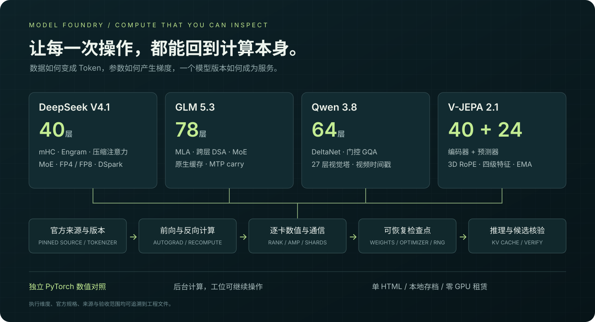

# 官方主干与后台执行验收 · v0.17.0

本版将三条语言/多模态路线和 V-JEPA 路线从浅层网络推进为按官方分支结构运行的可微计算图。层数、共享关系、路由、缓存、预测分支和视觉主干进入执行；参数更新影响同一模型后续的评测与推理。

## 落地的执行结构

| 路线 | 默认执行深度 | 本版落地 |
| --- | --- | --- |
| DeepSeek V4.1 Flash 1017 | 40 层文本 + 32 层视觉；3 层 DSpark | mHC、Sinkhorn、跨层压缩 KV/索引共享、两级候选检索、384 专家 top-6、共享专家、Engram 24 个哈希查询、窗口与不完整压缩块缓存、FP4/FP8 软件量化、DSpark/Markov/置信度分支、图像边界嵌入 |
| GLM 5.3 | 78 层文本；1 层 MTP | MLA 低秩 Q/KV、64 头、256 专家 top-8、前三层稠密、分组路由、选择偏置与加权分离、full/shared DSA 跨层索引复用、压缩 KV 缓存、MTP 目标隐藏状态及索引 carry |
| Qwen 3.8 27B | 64 层文本 + 27 层视觉；1 层 MTP | 三层 Gated DeltaNet / 一层门控 GQA；16 个 Key 头到 48 个 Value 头；24/4 Q/KV 头；因果卷积、衰减与递归状态；部分 mRoPE；3D patch 卷积布局、位置表插值、空间合并、视频时间戳与占位符展开 |
| V-JEPA 2.1 | 40 层编码器 + 24 层预测器 | 视频 tubelet、图像独立 patch 分支、三维 RoPE、四级特征 [9,19,29,39]、上下文和目标掩码、8 个 mask token、联合自注意力预测器、上下文/目标投影、L1 监督、停止梯度的 EMA 教师、部署裁剪预测器 |

“预测与验证”页会真正运行预测分支，再由主模型核验候选 Token。核验失败时使用主模型结果；它不能改变贪心解码结果。预测分支目前用于推理与核验，其参数默认冻结。

## 独立数值证据

独立参考使用 PyTorch CPU float64。DeepSeek 直接执行固定版本官方代码中的 Block/mHC、Engram、Gate、Expert 方法，并将低精度强制转换提升到 float64；其余张量计算在 PyTorch 中独立构建。浏览器实现的梯度不会传入参考求导器。冻结文件保存的是 PyTorch 输出和抽样梯度坐标。

| 对照对象 | 输出最大绝对误差 | 梯度最大绝对误差 |
| --- | ---: | ---: |
| DeepSeek 6 层边界参考图 | 3.22 × 10⁻¹⁵ | 1.20 × 10⁻¹⁴ |
| GLM 4 层参考图 | 4.88 × 10⁻¹⁵ | 3.29 × 10⁻¹⁴ |
| Qwen 4 层参考图 | 7.99 × 10⁻¹⁵ | 8.70 × 10⁻¹⁴ |
| Qwen 3 层视觉参考图 | 5.55 × 10⁻¹⁶ | 6.08 × 10⁻¹⁶ |
| DeepSeek 32 层视觉图 | 2.67 × 10⁻¹⁵ | 2.67 × 10⁻¹⁵ |
| JEPA 4+4 层参考图 | 2.00 × 10⁻¹⁵ | 2.85 × 10⁻¹⁴ |

另实际执行了 DeepSeek 40 层、GLM 78 层、Qwen 64 层的完整深度前向、重计算和反向，以及 JEPA 40+24 层反向；检查有限梯度与缓存。完整深度检查和小维度独立参考的作用不同，不把深度检查称为官方大权重逐值对照。

四路线完成数据→训练→各自后续阶段→评测→导出→部署；语言路线验证 GUI/API 缓存解码。浏览器的后台 Worker 与前台核验器逐元素对照；恢复、AMP、ZeRO 和历史工程机制继续回归。机器可读证据见 [独立参考](native-backbone-golden-v17.json)、[执行结果](native-backbone-verification-v17.json)、[固定来源及摘要](native-backbone-sources-v17.json)。断言数量表示检查范围，不表示工程完成比例。

## 工位与存档

训练样本、评测、GUI 推理、API 前向及候选核验进入内联 Worker。语言生成先 prefill，再复用缓存。取消后的旧样本结果不提交参数；推理上下文按请求释放。张量表分页和搜索，专家负载只展示本次被选中的专家。

逐卡地址索引采用紧凑稀疏数组；按层计算只聚合该层参数，避免每层重复构造整网权重。分片协议仍由实际 rank 状态决定优化器更新。

新导出格式为 `.foundry.gz`：Float64 数组分块、SHA-256 去重、gzip；打包在 Worker 中执行。检查点与资产 JSON 文件恢复后保持原字节摘要；支持旧 `.json` 存档导入。IndexedDB 使用同一压缩编码。测试覆盖原始字节、负零、保留字段、重复块、损坏块摘要和旧格式。浏览器 QA 用服务端准备的测试存档验证大工程恢复；扩展未允许自动选择本地文件，因此文件选择器的实际上传未计为通过。

## 官方规格与浏览器数值维度

工程的资源计划继续使用固定版本官方张量清单。浏览器实算使用 `architecture.json` 中明确的小维度，初始参数由种子生成，未加载官方大权重。两份维度各有用途，不能混作同一份物理模型：

| 路线 | 当前数值执行缩减 |
| --- | --- |
| DeepSeek | hidden=4、FFN=4、head_dim=8；Engram 真实逻辑哈希映射到 509 个物理表行；视觉 patch=2、grid=6。保留 40 层、64 头、384 专家及共享调度 |
| GLM | hidden=6、head_dim=8、Q/KV rank=2、expert_FFN=2、index_dim=4。保留 78 层、64 头、256 专家与 top-8 |
| Qwen | hidden=4、attention head_dim=24、linear head_dim=4；视觉 hidden=64、patch=2、grid=4。保留 64/27 层、GQA/Delta 头数及原生循环 |
| JEPA | encoder/predictor hidden=16、heads=2、patch=2、tubelet=2；保留 40/24 层和四级特征，掩码为可传入索引的参考规则 |

完整原生词表继续通过显式项目投影进入本地 softmax，最大 4096 行。像素采样仍采用固定的数值网格，尚未实现官方全部动态缩放、图像增强和视频解码。软件 FP4/FP8 舍入及 STE 已执行，尚无官方 CUDA 设备逐比特对照；公开推理源也不能替代未公开的完整预训练配方。

## 仍需继续落实的具体组件

| 路线/系统 | 现在的具体缺口 | 落地方向 |
| --- | --- | --- |
| Cosmos 3 Nano | 仍使用已有领域 flow 内核；尚无完整 Qwen3-VL 文本栈、DeepStack、36 层 MoT、原生视频 VAE | 依固定 checkpoint 组件分别接入理解、生成与动作流，保留模态掩码、时空位置、调制和 VAE 压缩布局 |
| GR00T N1.7 | 仍使用已有动作 flow；尚无 checkpoint 对应 16 层 VLM、24 层视觉、32 层动作 DiT 和 40×132 动作画布的完整执行 | 复刻 checkpoint 的实际组件、embodiment 选择、状态/动作编码、交叉注意力与归一化 |
| VLA-JEPA | 仍使用已有联合 action/world 图；尚无原生 28 层 VLM、16 层动作 DiT、24 层视频编码器和 12 层世界预测器的完整执行 | 接入双视角世界目标、动作条件预测和训练阶段冻结规则，部署明确裁剪世界分支 |
| 大词表与 Engram | 仍有物理行投影与碰撞 | 使用分块存储、稀疏梯度和可分页张量，推进更完整的逻辑地址计算与输出层 |
| 预测分支训练 | 目前默认冻结，未构造“官方未公开”的训练目标 | 公开配方与源代码可验证的部分独立接入，推理预测与主干核验继续单独验收 |
| 原版软件 | 已内联 MLflow 原版前端；其他控制台及全部产品功能未覆盖 | 对照固定发行版逐界面、逐请求、逐状态核验 |

上述缺口仍是实现任务，不将本版写成“全部官方内核已完成”。

## 复现

在仓库根目录运行 `npm run build`、`npm test`。独立参考及下载来源准备说明见 [参考工具](../tools/native-reference/README.md)。源码入口包括 `src/deepseek.js`、`src/native-trunks.js`、`src/native-vision.js`、`src/native-jepa.js`、`src/project-worker.js` 和 `src/archive.js`。
