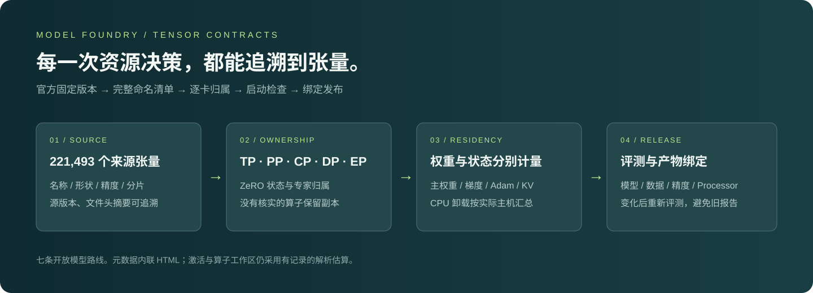

# v0.12：从来源张量到工程决策

这轮把资源规划从“模型总参数乘常数”改为命名张量清单。清单内联在 HTML，离线使用不需要下载权重。

## 来源与范围

截至 2026-11-27 核查的七条路线：GLM-5.3、DeepSeek-V4.1-Flash-1017、Qwen3.8-27B、V-JEPA 2.1、Cosmos3-Nano、GR00T N1.7、VLA-JEPA。完整来源版本、分片 URL 与文件头 SHA256 见 [来源摘要](模型张量来源与摘要.json)。共内联 **221,493 个来源张量条目**，包含 EMA、辅助资产和来源量化 scale；这个数不等于可训练参数个数。

读取 safetensors 索引与每个分片文件头；V-JEPA 读取 PyTorch ZIP 目录和受限解析的元数据，不加载 tensor storage。六份 safetensors 清单与官方索引的名称、归属和数据边界核对一致。未下载大权重载荷。

GR00T 的实际文本骨干是 16 层，动作 DiT 是 32 层、FFN 6144；旧资料中被 gate 阻挡的形状现在以完整 checkpoint header 补齐。VLA-JEPA 动作 FFN 为 3072。Cosmos 原始整包中的生成专家、视频 VAE 和音频组件分别计量。DeepSeek 的 I8 专家恢复双倍逻辑输入维度，Engram 则保持 FP8 表形状。

## 操作

创建模型工程后，打开“资源与容量”。修改 `recipe.json` 中的 `dtype`、`gpus`、`tp`、`pp`、`cp`、`ep`、`zeroStage`、`offload`、`microBatch`、`sequenceLength`；表格重新计算每个 rank 的权重、梯度、FP32 主权重与 Adam、参考模型、激活、KV 和 CPU 卸载。

`capacity-spec.json` 固定来源版本、inventory 摘要、逻辑形状覆盖、冻结前缀、显式共享别名、MTP 开关和活跃模态。改变容量规格后不能继续发布旧产物。资源合同随运行及产物保存，启动检查使用冻结计划，不读取之后被修改的编辑器内容。

- `world_size = TP × PP × CP × DP`；EP 是 DP 内的专家子组，不额外乘 world size。
- DP 本身不减少权重；ZeRO 1/2/3 分别控制优化器、梯度与参数状态分片。专家状态使用专家自己的 DP 组。
- 按名字分配 PP 层，按已核对的矩阵方向划分 TP；Qwen 的融合 Q/K/V 按三个通道区间切分。未知算子保持复制，避免编造显存收益。
- LoRA 仅计适配器优化器，QLoRA 使用打包 INT4 与逐行 scale；DPO/GRPO 计入参考策略。参数共享只用于明确共享的冻结底座。
- 卸载按分配到同一主机的 rank 汇总，并计入其他模型工程、部署和 Atlas 作业；两个调度入口都会检查共享主机内存。
- 服务阶段排除优化器和梯度。V-JEPA 默认只保留 target encoder；VLA-JEPA 剔除训练用 video encoder/predictor。MTP 与模态组件按开关选择。

## 数值与状态修复

新领域工程的隐藏维度、头数、编码层、patch、图像大小、帧数和动作 chunk 进入实际计算图，保存后恢复仍按同一结构执行。删除 JEPA 无用的 text/state 参数与 VLA 未使用的 level 参数。新 JEPA 使用 L1 潜表示损失；旧存档保留原 MSE 协议。动作归一化只从训练集统计，可要求物体到位、任务成功和碰撞门槛。

阶段切换默认重置优化器；显式 `optimizerPolicy: "continue"` 必须核对权重、方法、结构和精度。LoRA 合并、量化或改精度不能带入不匹配的旧 master。FP16 适配器溢出会完整跳过参数与矩状态更新，并降低 loss scale。

父产物按前置阶段选择、读取前核对摘要。提交失败不清空已完成阶段，也不消耗运行编号。评测绑定容量、执行精度、门槛、Processor、归一化与模型数据；部署必须通过当前评测。

## 原生软件对照

真实 MLflow **3.0.1** 已在隔离环境启动，通过 HTTP API、SDK、CLI 与 SQLite 停止重启采集 25 个用例。原始实跑记录见 `docs/external/`。

真实 Grafana **12.0.0** 与 Prometheus **3.3.0** 对照通过 29 个 API/CLI 用例与 68 次告警采样，覆盖 PromQL 解析错误、数据源恢复、Dashboard 412 版本冲突与修复、告警状态转移，以及 Prometheus 停止重启。所有隔离 PID 树与端口已清理。这些服务使用受控 exporter 指标，未采集真实 GPU 性能。

产品中的 `Tracking server API` 页面和终端已接入其中的错误语义：重复实验返回 400、同值参数可重复写而改值返回 400、非法筛选 400、缺失运行 404，停止重启后保留状态。

实跑还保留了一条环境故障：依赖 metadata 允许 SQLAlchemy 2.1.9，pip 安装和检查通过，但 MLflow 启动缺少 `FallbackAsyncAdaptedQueuePool`；固定到 2.0.41 后恢复。产品复现启动期错误，没有把它伪造成安装期解析失败。

## 仍未闭合的部分

命名来源清单完整不代表官方执行内核完整。DeepSeek 的 HC、Engram、共享压缩 KV、DSpark 尚未整体接入当前数值执行器；世界与动作模型仍为可微缩放计算图，尚非所有官方逐算子结构。官方未公开的 DSpark 训练损失也无法按原方复现。

激活与工作区使用解析公式，尚无真实 GPU profiler 校准；未知 TP 规则保守复制。领域内核当前提供 full 训练，未落地的适配器/策略优化会拒绝启动，避免配置写了却无效。原生软件 API 的有限用例对照不等于软件全部界面、插件与部署场景复刻。原 Atlas 100 项台账没有因此提高完成项，也不将测试数量当作全产品真实性百分比。
