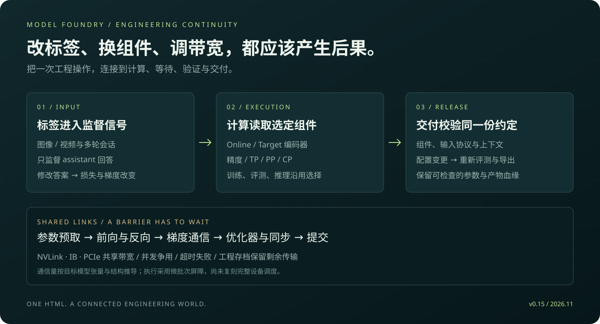

# v0.15：让数据、组件、计算与交付保持一致

验收日期：2026-11-28。对应 `model-execution-v1` 与 `project-links-v1`。本轮落实 v0.14 功能审查中发现的四处脱节，并补齐通信等待的保存与恢复。

## 修复前后的实际差异

| 位置 | v0.14 行为 | v0.15 行为与证据 |
|---|---|---|
| JEPA 推理 | 部署规划使用 target_encoder，数值推理读取 online encoder | 默认读取 targetParameters；修改目标编码器会改变输出，单独修改 online 参数不改变默认输出；可在 capacity-spec.json 的 serving.encoder 选择 online。 |
| 多模态 SFT | 使用 caption，messages 中的回答不影响训练 | 图像、视频和多轮会话共用参考序列协议；只监督 assistant 内容及正常结束的 EOS；改变回答会改变损失和梯度。 |
| 领域推理 | 使用非数值分片图，忽略 dtype / TP / PP / CP | 推理运行 RankNumerics 的矩阵分片、阶段传递和上下文聚合；声明精度进入权重与计算路径；推理记录实际组件和事件。 |
| 模型项目通信 | 带宽记录在元数据，未阻止训练越过通信 | 参数预取、每个全局微批次后的归约、更新同步都有等待屏障；传输未完成时不发布训练步与产物。 |

## 可直接操作

1. 在模型工程选择 Qwen3.8-27B，准备环境并完成数据检查。示例记录交替使用 `mediaKind: image / video`，也可从数据工作台编辑 JSONL。
2. 视觉对齐阶段冻结语言骨干，更新视觉部分；SFT 阶段按 messages 或 prompt/completion 进行监督。配方仍可选择 full、LoRA、QLoRA。
3. “批次与恢复”并排查看全局批次和通信阶段。暂停时也能点击“推进 10 工程秒”，推进后仍保持暂停，便于逐步观察。
4. 任何屏障期间都可以保存工程检查点。取消后恢复，保留参数、优化器、随机状态、采样进度、累积梯度和剩余传输。
5. 评测、导出、部署固化同一份执行约定：输入协议、上下文、精度、并行、组件、推理种子和积分步数。已有部署执行条件不匹配时返回 409，要求重新评测与发布。

SFT 采用本项目的 UTF-8 字节参考序列协议 `reference-chat-v1`，包含角色边界和回答掩码。超出上下文时保留最后一组用户与回答；被截断的回答不添加虚假的结束标记。原始文本预训练明确要求 text，不会将缺少 text 的会话记录当成字符串 undefined 训练。

GUI 与项目 Chat API 使用相同的会话序列化、媒体选择及上下文预算。项目 API 可指定 `record_id`，typed image/video 消息使用本地记录内的 RGB 数据，不抓取 image_url 的远程资源。temperature=0 下，API 缓存解码与 GUI 贪心输出一致。

## 通信如何影响执行

- ZeRO-3 参数聚合按目标张量的权重字节数规划；普通参数与专家参数分别使用数据组和专家组。CPU 卸载增加 PCIe 传输。
- 梯度 AllReduce / ReduceScatter 使用可训练参数量；视觉对齐阶段冻结的语言参数不增加训练梯度传输。
- TP / CP / PP 的激活通信按固定版本的模型几何结构推导。多个模型项目共用主机 NIC、NVLink、PCIe 和 spine 容量，动态公平分配带宽。
- 同节点只使用 NVLink，跨主机才使用 IB。节点 IB 速率还受硬件上限、netctl 配置和故障系数约束。延迟与 watchdog 都进入事件时间。
- watchdog 默认读取硬件配置；可在 recipe.json 设置 `collectiveTimeoutSeconds`（大于 0，最多 600）。失败不发布未完成更新；恢复当前状态时保留传输进度并重新计时。

这里的检查点同时承担浏览器工程世界的保存功能，包含通信引擎状态；不代表真实 NCCL 支持从任意已传输字节继续一次 collective。数值分片更新和发布步骤分开保存，恢复更新同步阶段不会重复调用 Adam。

## 验收结果

新增 **332 项检查**，累计 **3,126 项工程断言**。历史回归及三组独立 NumPy 对照通过。原始结果见 [执行协议验收结果](执行协议验收结果.json)。

| 实验 | 结果 |
|---|---|
| 多模态 assistant 回答 left → right | 损失差 0.207264；最大梯度差 40.414860。 |
| JEPA 目标编码器单参数修改 | 输出最大差 0.994254；仅修改 online 参数时默认输出差为 0。 |
| 1 GB/rank 两节点传输，400 → 100 Gbps | 0.020005 → 0.080005 工程秒。 |
| 同样传输位于同一节点，IB 400 → 1 Gbps | 都为 0.004449 工程秒，由 NVLink 限制。 |
| 两个并发项目共用 NIC | 0.020005 → 0.040005 工程秒。 |
| GR00T 目标张量、两节点完整更新，400 → 100 Gbps | 通信阶段合计 0.829258 → 3.316989 工程秒。 |
| ZeRO 0 / 1 / 2 / 3 | 梯度通信及更新同步中保存恢复，最终权重、目标参数一致；Adam 只更新一次。 |
| 七条模型路线 | 各自从数据到训练、评测、导出、部署及一次推理通过。 |

浏览器验收实际点击了继续/暂停、推进时间、保存、取消和从批次中间恢复。显示中间批次与传输状态；使用独立验收端口和固定工程，不覆盖用户已有浏览器工程。自动化数值验收为隔离执行行为，提升虚拟准入上限；该设置不随产品默认硬件发布。

## 距离完整 1∶1 的剩余差距

本轮没有把“全部官方内核与软件界面复刻”计为完成。具体仍有：

- 数值模型采用可运行的缩小结构，尚未加载并执行各官方完整大型骨干和完整权重；官方 Tokenizer、Processor 与聊天模板也未逐一复刻。
- 通信采用按微批次分阶段的保守屏障和目标规模流量，不含完整逐层预取重叠、硬件拓扑路由、原生 EP AllToAll 与真实 GPU kernel 调度。旧 Atlas 调度器保留独立事件引擎，尚未和模型项目共用同一套链路竞争状态。
- 计时是工程世界的离散事件结果，激活和部分工作区仍为解析估计；不是 CUDA profiler 或真实硬件吞吐测量。
- Python 执行范围仍以已实现的解释器和 loss_weight 回调为界，不能运行任意官方训练仓库。系统、依赖和容器为浏览器内语义实现，尚非完整 Linux 环境。
- MLflow / Grafana 已有部分真实服务 API 对照，界面、插件和所有故障流程未逐页复刻。具身闭环仍是简化运动环境，未等同于 Isaac Sim / MuJoCo 的完整三维物理与任务集合。

后续按这些明确边界继续补齐；检查数量只描述本次验证范围，不能转换成真实性百分比。
