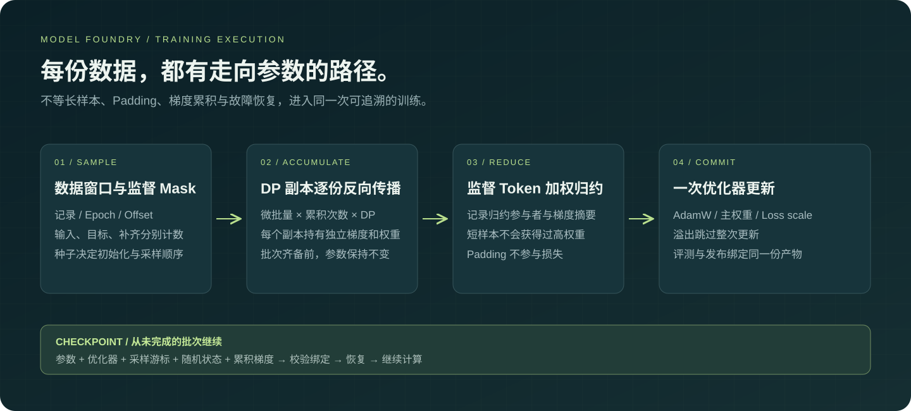

# v0.13 批次执行与检查点

这轮修复的是配置与计算之间的脱节。此前修改 `microBatch` 或 `sequenceLength` 会改变资源估计，但项目训练仍可能只计算一份固定长度样本。新提交的项目训练采用 `project-training-v2`，把批量、序列、累积和恢复状态写入同一个执行合同。



## 可操作路径

在模型工程的“配方与依赖”编辑 `recipe.json`，提交训练，再打开“批次与恢复”。界面显示冻结批量、当前批内进度、数据 Epoch、Offset、输入/目标/Padding 数量、DP 梯度贡献、归约摘要和优化器成功/跳过次数。

```json
{
  "microBatch": 2,
  "gradientAccumulationSteps": 4,
  "sequenceLength": 32,
  "checkpointInterval": 10,
  "seed": 42,
  "shuffle": true,
  "adamBeta1": 0.9,
  "adamBeta2": 0.999,
  "adamEps": 1e-8
}
```

若 `gpus=8, tp=4, pp=1, cp=1`，DP 为 2，全局批量为 `2 × 4 × 2 = 16`。这里是每次优化器更新使用的实际样本数。窗口索引与 RNG 决定每份数据的顺序；多个 DP 副本分别产生梯度贡献，达到累积屏障后归约并提交一次 AdamW。各样本在浏览器中依次执行，不代表在真实 GPU 上并行运行。

## 执行规则

| 环节 | 实际行为 |
|---|---|
| 文本预训练 | UTF-8 字节 Token 加 BOS/EOS，按输入序列长度建立相邻目标窗口；长文档可以跨窗口消费。 |
| SFT / 多模态 | 根据实际上下文形成监督 Mask，右侧补齐；视觉前缀与 Padding 不参与语言监督。 |
| DPO / GRPO | 按偏好对/提示组平均；GRPO 采样提示记录，输入计数包含提示上下文。 |
| 梯度累积 | 预训练/SFT 按监督 Token 数加权，避免短样本被过度放大；DPO/GRPO/领域目标按样本平均。 |
| 混合精度 | 保留 FP32 主权重与 Adam 状态；FP16 非有限梯度跳过整次更新并降低 Loss scale。 |
| 领域模型 | JEPA、视频 flow、动作 flow、联合动作/世界模型共同使用批次屏障；JEPA EMA 在更新提交后执行。 |
| 数据游标 | 当前批次先使用工作游标；完成一次更新尝试后提交。AMP 跳步保留已消费数据的记录。 |
| 评测 | 文本按完整验证文档窗口计算 Token 加权损失，输入协议和序列长度进入评测摘要。 |
| UI | 更新动态数值和表格，保留交互控件；计算繁忙时仍调度页面刷新，避免反复刷新导致按钮难以点击。 |

## 检查点操作

训练中点击“保存当前检查点”，即使当前只完成 `1/16` 份样本，也会保存已产生的梯度。取消运行后，选择一个检查点的“从此处恢复”，然后继续工程时钟。

检查点保存参数、优化器、冻结配方和计划、当前数据顺序与游标、RNG、参考策略、尚未完成的梯度贡献、指标与数值轨迹。内容摘要、工程/运行、数据/训练源码、计划、张量形状与采样器结构在恢复前校验；失败保持现状。LoRA 的参考策略恢复共享不可变基座。恢复任务不回拨整个机房的时间，也不重新发布尚未提交的资产。

自动检查点按成功更新间隔保存，最后一次更新也保存。文件在工程虚拟路径 `/projects/<project>/checkpoints/<run>/`，随本地工程存档持久化，导出工程时一并携带。

## 验收证据

可重复执行 `node verify-v13.cjs`，完整回归使用 `npm test`。测试覆盖微批量分组等价、DP 与单副本批量等价、序列变化改变实际参数、Token 加权梯度、Padding 零贡献、完整 AMP 跳步、部分累积检查点重放、JSON 存档恢复、七模型端到端流程、LoRA/QLoRA、GRPO，以及四条领域路线的随机流/优化器/目标编码器精确恢复。

数值执行测试将虚拟 GPU/主机准入上限临时提高，以隔离执行语义；不以这些测试作为资源容量或性能证据。浏览器验收另用 8×80 GiB GPU / 1024 GiB 主机的独立 Qwen LoRA 工程，实际点击保存、取消、恢复、继续与暂停，并观察动态累积进度。1366×768、390×844 下页面宽度未超出视口。

结果摘要见 [批次验收结果](批次验收结果.json)。历史总检查数反映累计验证范围，不是产品真实性比例。

## 保留范围

- 数值骨干仍为有边界的浏览器计算图，并未变成七个官方模型的完整原生内核。
- 文本执行序列不能超过 `architecture.json` 的 `max_position_embeddings`，新项目默认 64；超限明确拒绝。SFT/偏好对仍按该上下文截断，不能据此宣称覆盖官方超长上下文。
- 世界/具身/决策模型从帧、Patch 和动作 Chunk 推导结构；不能用 `sequenceLength` 冒充领域序列长度，显式填写会拒绝。
- 每卡微批量和累积次数各限 128，DP 限 32，全局批量限 4096，梯度缓冲有浏览器内存上限。域内前向/反向的单次算子仍可能阻塞一帧，不是独立 GPU Worker。
- TP/PP/CP 数值切分已有参考实现；EP/ZeRO 的全部实际所有权、全部官方算子与真实硬件 profiler 校准仍未补齐。
- 历史活动运行保留原协议，新提交训练使用 v2；旧配方若超过可执行上下文，需要明确修改后再提交，避免静默截断。
