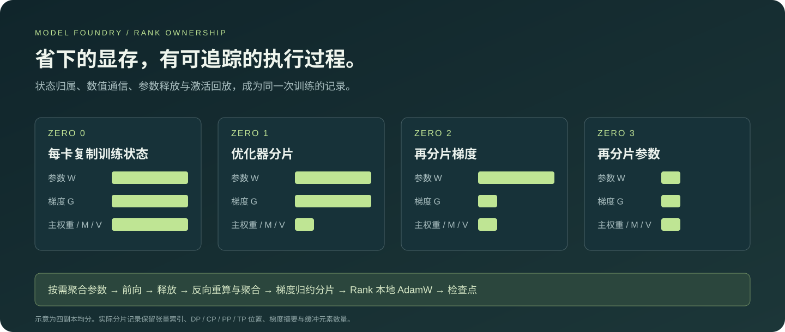

# v0.14：逐 rank 状态与激活重计算

这一轮解决 v0.13 审查中的两项脱节：ZeRO 只改变容量规划、重计算只减少估计激活。新提交项目增加 `rank-training-v1` 状态协议，实际训练读取并更新各 rank 的缓冲；激活检查点在反向传播时重新执行计算块。

## 已实现的行为

| 配置 | 数值执行器实际行为 |
|---|---|
| ZeRO-0 | 每个数据副本保留其参数、梯度与优化器状态。 |
| ZeRO-1 | 主权重及 Adam M/V 只保存在所属分片，更新后聚合并复制参数。 |
| ZeRO-2 | 梯度贡献直接归约到所属分片，跨微批次在分片内累积；不另藏一份完整 DP 梯度。 |
| ZeRO-3 | 再分片参数；执行时按需聚合，前向后释放，反向前重新聚合，更新只修改所属 rank 的主权重和矩状态。 |
| CPU 卸载 | rank 状态位置记录为 CPU，计算范围内装载、使用并释放参数工作缓冲。 |
| 激活重计算 | 层内前向不保留可微 tape；保留边界，反向时重建局部计算图，传回输入梯度与参数梯度后释放。 |
| 适配器 | LoRA/QLoRA 的 A/B 梯度进入分片优化器；基座冻结。导出时重建兼容的优化器检查点。 |
| 混合精度 | 沿用参考内核的数值舍入和 FP32 主权重；非有限梯度或 FP16 参数溢出跳过所有 rank 的更新。 |

语言/多模态解码器按 Embedding、视觉处理、每层解码器及输出头组织参数范围。领域网络当前以整个网络作为参数暂存单元，其编码层和 flow 块分别支持激活重算。资源规划使用相同边界，加入 ZeRO-3 参数聚合空间及 QLoRA 反量化暂存，避免仅以分片常驻权重计算峰值。

状态缓冲按数值张量的 TP/PP 与 DP/CP 归属建立索引。模型参数和优化器的合并视图保留在主机，用于检查点、资产和数值对照；它不计作每卡复制的优化器状态。部分数值张量采用保守 TP 复制规则，与官方目标容量投影分别显示。

## 可操作路径

1. 在模型工程的 `recipe.json` 设置 `zeroStage: 0/1/2/3`、`recompute: true/false`，保存后提交训练。
2. 打开“批次与恢复”，查看“逐 RANK 状态与重计算”。表格显示每个 rank 持有的参数、梯度、主权重、M/V 数量及 CPU/GPU 位置。
3. 展开事件，检查参数聚合、释放、梯度 ReduceScatter 与本地 AdamW 更新。
4. 保存当前检查点，取消运行，再选择恢复点。分片、采样器、部分梯度、随机状态和优化器一起恢复。

本轮接入模型工程训练；既有 Atlas 作业保留其原分布式执行协议。领域 flow 的噪声与时间采样会更新工程中的 RNG，并随检查点精确恢复。

历史运行保留旧执行计划；需要新提交训练才采用该协议。源文件错误、源数据撤回、环境改变和节点故障的原有检查仍生效。

## 证据与验收

- `verify-v14.cjs`：443 项断言，覆盖 ZeRO 0/1/2/3 的更新等价、真实缓冲数量变化、PP/CP 组合、逐层释放/重新聚合、LoRA/QLoRA、AMP 原子跳步、损坏分片拒绝、优化器延续，以及七条模型路线的恢复与训练到服务流程。
- GLM、Qwen、LoRA/QLoRA 的分片更新另外对照原有密集优化器；重计算前后的前向和梯度独立比较。
- 独立 NumPy 参考：普通 Transformer、GLM、Qwen 及四类领域网络均通过；原生前向最大误差约 `4e-15`，领域损失误差小于 `1e-15`。
- 修复可变隐藏维度时 flow 时间调制梯度的硬编码，以及单编码层世界分支的目标摘要索引；用隐藏维度 8/32、单编码层及有限差分验证。
- 历史回归通过；累计 2,794 项工程断言。总数不代表全产品真实性百分比。

浏览器验收在隔离源使用 Qwen LoRA 工程，虚拟准入配置为 8×80 GiB / 1024 GiB 主机、TP=4、DP=2。通过真实界面编辑配方，从 ZeRO-0 改为 ZeRO-3：每 rank 参数、梯度和优化器状态均减半。界面记录每样本 6 次计算块回放；保存 `5/8` 个样本的检查点后恢复，并继续提交更新。1366×768 与 390×844 页面无横向溢出，观察到的控制台错误为 0。

自动数值测试临时提高虚拟资源准入上限，以隔离计算语义；不将其作为实际容量或性能证据。精确摘要见 [验收结果](分片重算验收结果.json)。

## 精度与范围

这些是浏览器数值执行器的实际状态分片与计算图回放，不代表已运行 CUDA/NCCL，或达到原软件完整二进制兼容。AD 节点数据统计不含全部算子闭包、注意力临时数组、缓存或真实 GPU 工作区；显示的节点峰值是该统计范围的上界。回放工作比例计入工程时钟，GPU 耗时仍需要硬件校准。

官方目标的激活/工作区仍采用解析公式。EP 已有规划及状态归属，完整专家 dispatch/combine 通信未实现；不计作补齐原生 EP。DeepSeek 专属完整骨干、各型号官方 Tokenizer、完整脚本训练循环、全部原生软件界面、生产推理调度与三维具身环境仍保留各自范围。本轮没有把这些算作完成。
